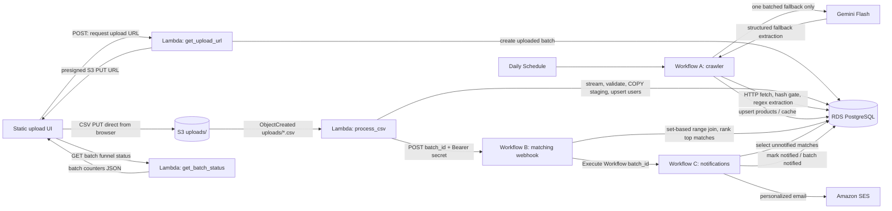

# Loan Eligibility Engine

A small, auditable loan-eligibility pipeline for CSV applicant uploads. It uses AWS Lambda for ingestion, PostgreSQL for deterministic matching, n8n for orchestration, Amazon SES for notifications, and Gemini only as a crawler fallback.

## Architecture



## Repository map

| Path | Purpose |
|---|---|
| `ui/index.html` | Single-file browser upload and live-funnel UI. |
| `lambdas/` | Lambda handlers and shared psycopg connection helper. |
| `infra/serverless.yml` | AWS resources, Lambda functions, IAM, S3 event, and DLQ. |
| `db/init.sql` | Schema, indexes, and timestamp triggers. |
| `db/seed_products.sql` | Six demo products used as crawler fallback data. |
| `n8n/` | Save exported Workflow A, B, and C JSON files here. |
| `scripts/local_ingest.py` | Local fake-S3 ingestion harness. |

## Setup and deployment

### Prerequisites

- Docker Desktop and Docker Compose
- Python 3.11 for the deployed Lambda runtime
- Node.js 20+ and Serverless Framework v3
- AWS credentials able to deploy S3, Lambda, API Gateway, SQS, and related resources
- A reachable n8n instance for deployed Lambda-to-webhook calls
- A Gemini API key only if Workflow A's regex fallback is enabled

### Environment

```sh
cp .env.example .env
```

Set at least these values:

```dotenv
POSTGRES_PASSWORD=use_a_local_secret
DB_HOST=localhost
DB_PORT=5432
DB_NAME=loan_eligibility
DB_USER=loan_app
DB_PASSWORD=use_a_local_secret

# For deployed Lambda, this must be a reachable n8n production webhook, not localhost.
N8N_WEBHOOK_URL=https://your-n8n.example.com/webhook/loan_match
WEBHOOK_SECRET=use_the_same_secret_as_n8n_header_auth

# Used by Workflow C inside n8n.
TEST_MODE=true
GMAILUSER=your.gmail.username
SES_FROM_EMAIL=verified-sender@example.com
AWS_REGION=ap-south-1
```

Add `TEST_MODE`, `GMAILUSER`, `SES_FROM_EMAIL`, and `AWS_REGION` to the n8n service environment in `compose.yaml` if Workflow C reads them through `$env`.

### Start local services

```sh
docker compose up -d
docker compose ps
```

Open n8n at [http://localhost:5678](http://localhost:5678). Confirm the schema:

```sh
docker compose exec postgres sh -c 'psql -U "$POSTGRES_USER" -d "$POSTGRES_DB" -c "\\dt"'
```

The first Postgres-volume initialization creates the schema and loads six seed products. Init scripts run only on a new volume.

### Deploy infrastructure

```sh
cd infra
npm install --save-dev serverless serverless-python-requirements
export DB_HOST='your-rds-endpoint.amazonaws.com'
export DB_PORT='5432'
export DB_NAME='loan_eligibility'
export DB_USER='loan_app'
export DB_PASSWORD='your-rds-password'
export N8N_WEBHOOK_URL='https://your-n8n.example.com/webhook/loan_match'
export WEBHOOK_SECRET='the-shared-webhook-secret'
npx serverless deploy --stage dev
```

Set the deployed API Gateway base URL in `ui/index.html` and disable mock mode:

```js
API_BASE_URL: 'https://YOUR_API_ID.execute-api.ap-south-1.amazonaws.com/dev',
MOCK_MODE: false,
```

For private RDS, attach Lambda to the RDS VPC/subnets and a security group that allows PostgreSQL access. Store deployed database credentials in deployment secrets rather than committing them.

### n8n credentials and workflow imports

Create these credentials in **n8n → Credentials**:

1. **Loan Eligibility Postgres** — PostgreSQL: `postgres` locally or the RDS endpoint; port `5432`; database `loan_eligibility`; user `loan_app`.
2. **Loan Match Webhook Auth** — Header Auth: header name `Authorization`, value `Bearer <WEBHOOK_SECRET>`.
3. **Loan Eligibility SES** — AWS access key/secret in the verified SES Region, with `ses:SendEmail` permission for the sender identity.

After building them in the n8n UI, export the workflows to:

```text
n8n/workflow-a-daily-crawler.json
n8n/workflow-b-matching.json
n8n/workflow-c-notifications.json
```

To import: n8n canvas → **⋯** → **Import from File** → choose one JSON export → assign the credentials above → save → activate. Activate Workflow B before testing uploads so `/webhook/loan_match` exists.

### SES identity

1. In the intended Region, open **Amazon SES → Verified identities**.
2. Verify `SES_FROM_EMAIL`, or preferably your sending domain.
3. While in the SES sandbox, verify each recipient too.
4. To verify your Gmail inbox, create an email identity for the Gmail address and open the verification link sent to it.
5. Request SES production access before using arbitrary `GMAILUSER+userid@gmail.com` aliases. A base Gmail identity does not reliably authorize every dynamic plus alias in the sandbox.

The SES sandbox default is 200 recipients per rolling 24 hours and one recipient per second, per Region. [AWS SES quotas](https://docs.aws.amazon.com/en_en/ses/latest/dg/manage-sending-quotas.html)

### End-to-end test

1. Keep `TEST_MODE=true` and ensure the SES recipient strategy is valid for your sandbox/production status.
2. Create a CSV:

```csv
user_id,email,monthly_income,credit_score,employment_status,age
demo-001,ignored-in-test@example.com,55000,735,salaried,31
demo-002,ignored-in-test@example.com,30000,675,self_employed,27
```

3. Activate Workflows A, B, and C. Workflow B must expose `/webhook/loan_match`.
4. Serve the UI:

```sh
python3 -m http.server 8080 --directory ui
```

5. Visit [http://localhost:8080](http://localhost:8080), select the CSV, and upload it.
6. Verify the UI reaches the Emailed stage, check n8n executions, then check Gmail.
7. Confirm persisted counters:

```sh
docker compose exec postgres sh -c 'psql -U "$POSTGRES_USER" -d "$POSTGRES_DB" -c "SELECT batch_id, status, total_users, valid_users, rejected_users, after_range_join, matched_count, near_miss_count, emailed_count FROM batches ORDER BY created_at DESC LIMIT 1;"'
```

For local ingestion alone, without AWS:

```sh
python scripts/local_ingest.py scripts/sample_users.csv "$(uuidgen | tr '[:upper:]' '[:lower:]')"
```

## Design decisions

### Upload pattern, staging, and COPY

The browser requests a short-lived presigned S3 PUT URL, then uploads directly to S3. This avoids routing potentially large CSV bytes through API Gateway or Lambda. The S3 event starts ingestion, which streams rows rather than loading the complete file into memory.

Valid rows are chunked into constraint-free `staging_users` with PostgreSQL `COPY`; one set-based upsert moves the batch into `users`. Invalid rows are retained in `rejected_rows` with the raw JSON input and reason. This is substantially more efficient than a database insert per CSV row.

### Optimization Treasure Hunt: the matching funnel

1. Range join users in the batch to active loan products.
2. Apply income, score, age, and employment predicates in SQL.
3. Calculate a normalized eligibility margin.
4. Rank products per user.
5. Keep only the best three passes and one close numeric near miss.

There are **zero LLM calls in matching**. Per-pair LLM decisions would be expensive, non-deterministic, difficult to audit, and grow with the user-product cross product. PostgreSQL can evaluate and rank thousands of records as one set-based operation.

### Crawler strategy

Workflow A fetches a small lender-page config list daily, strips non-content HTML, normalizes text, and checks a SHA-256 hash in `page_cache`. Unchanged pages skip extraction. Changed pages use regex first; only failures are combined into one Gemini Flash request for the run.

Gemini failure produces a `degraded` crawl run and keeps existing products. If all crawler pages fail and no active product exists, the idempotent SQL seed products are loaded.

### Idempotency and near-miss email safety

- Every upload has a UUID batch and durable funnel counters.
- Users and products are upserted by their natural keys.
- Match insertion uses `ON CONFLICT DO NOTHING`, so `notified = true` is never reset.
- Workflow C selects only false notifications and marks precisely the successfully sent product IDs true.
- Near misses are clearly phrased as close options, not approvals.

### Honest limitations

- Lender page URLs and eligibility wording can change.
- Regex and fallback extraction can misinterpret ambiguous pages; human review is needed before production use.
- The current non-null product thresholds require a policy for missing published criteria; those defaults must not be portrayed as lender guarantees.
- SES sandbox cannot practically support arbitrary Gmail plus aliases.
- Eligibility is indicative; lender underwriting and verification are authoritative.

## Cost and scale notes

| Area | Cost / scaling posture |
|---|---|
| Direct S3 upload | Avoids Lambda/API Gateway payload handling; S3 handles object delivery. |
| Ingestion | Streaming plus chunked COPY bounds Lambda memory and reduces database round trips. |
| Matching | One indexed SQL operation per batch; no model cost per user-product pair. |
| Gemini | Usually zero calls because hashes and regex handle unchanged/ordinary pages; at most one batched fallback per crawl. |
| n8n | Self-hosted cost is the Docker host; rate-limit SES sends. |
| SES | Sandbox starts at 200 recipients/day and one recipient/second; quotas are regional. |
| RDS | Begin small; add pooling, VPC tuning, and monitoring before production scale. |

## Seven-minute demo script

| Time | Show | Say |
|---:|---|---|
| 0:00–0:30 | Mermaid architecture diagram | “A CSV goes directly from the browser to S3. Lambda validates it into Postgres, n8n matches applicants, and SES sends results. Gemini is only a crawler fallback.” |
| 0:30–0:55 | `docker compose ps`, then n8n | “Postgres and n8n run locally. The same DB environment contract supports RDS when deployed.” |
| 0:55–1:20 | `db/init.sql`, then seeded products | “The schema tracks batches, rejected rows, products, matches, cache, and runs. Seeds let the demo work when crawling is degraded.” |
| 1:20–1:45 | UI in mock mode | “The UI supports drag-and-drop upload and a live funnel. Mock mode records the whole visual flow without AWS.” |
| 1:45–2:15 | Live UI upload | “The UI requests a ten-minute presigned URL, then uploads directly to S3. Application credentials and file bytes do not pass through the page.” |
| 2:15–2:45 | `get_upload_url.py` and `process_csv.py` | “The S3 event streams CSV rows, validates them, writes valid chunks with COPY to staging, upserts users, and stores rejected rows with reasons.” |
| 2:45–3:10 | Parsed UI stage and `batches` query | “Batch counters make the funnel durable. Ingestion posts only a batch ID and Bearer secret to Workflow B.” |
| 3:10–3:40 | Workflow A nodes | “Workflow A hashes pages before extraction, uses regex first, and makes at most one batched Gemini request only for failures.” |
| 3:40–4:10 | Workflow B webhook and SQL node | “Workflow B range-joins users to products, calculates margin, identifies one small near miss, ranks matches, and keeps the best three.” |
| 4:10–4:35 | Matching SQL / `matches` table | “This is the optimization treasure hunt: no LLM per pair. SQL is deterministic, auditable, inexpensive, and scales to thousands of users.” |
| 4:35–5:05 | Range matched and Matches kept UI stages | “The UI polls batch status every two seconds and displays both broad range matches and the smaller ranked set.” |
| 5:05–5:35 | Workflow C nodes | “Workflow C aggregates matches per user, sends one recipient at a time, waits 1.1 seconds for SES limits, and updates notification state only on success.” |
| 5:35–6:00 | Workflow C Code node | “It builds both HTML and plain-text email deterministically, separates close calls from passes, and includes a lender-verification disclaimer.” |
| 6:00–6:25 | TEST_MODE and SES configuration | “Test mode rewrites every recipient to my Gmail alias; CSV addresses are never used. Successful sends alone set notified true.” |
| 6:25–6:45 | Emailed stage and batch query | “The batch now has a notified status and final emailed-recipient count.” |
| 6:45–7:00 | Gmail inbox and opened email | “The email lists candidate products first, near misses separately, and makes clear that final approval belongs to the lender.” |
