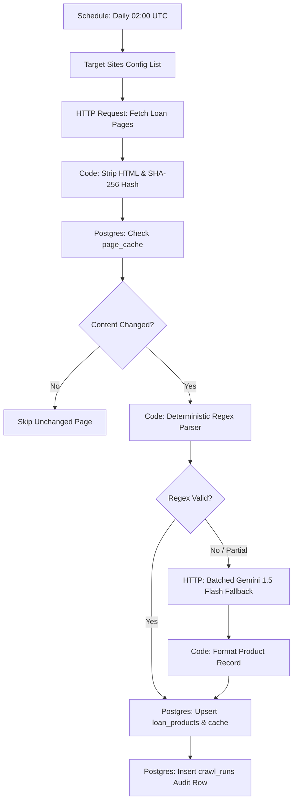

# Workflow A: Loan Product Discovery (Web Crawler)

This document is the architectural and operational guide for **Workflow A (The Crawler)**. It runs on a scheduled cadence (or manually via editor trigger), discovers personal loan products from public bank websites, uses a hash cache to avoid duplicate processing, applies deterministic regex extraction, falls back to a single batched Gemini 1.5 Flash request when regex extraction fails validation, and safely upserts results into PostgreSQL.

---

## 1. Node-by-Node Pipeline Architecture



---

## 2. Key Design & Optimization Strategies

### A. SHA-256 Hash Gate (Eliminates Redundant AI/Database Calls)
Before running expensive parsing logic, the workflow strips HTML boilerplate (`<nav>`, `<header>`, `<footer>`, `<script>`, `<style>`) and normalizes all whitespace. It computes a SHA-256 cryptographic digest of the sanitized text and checks `page_cache`:
```sql
SELECT content_hash, last_extracted FROM page_cache WHERE url = $1;
```
If the hash matches the previous crawl, the page is skipped immediately.

### B. Deterministic Regex Rules First (Zero-Cost Extraction)
Instead of piping full HTML into an LLM on every crawl, a fast JavaScript parser extracts:
* **Interest Rate:** Matches patterns like `starting at 10.5% p.a.`, `ROI 10.75%`, `11.25%`.
* **Minimum Income:** Parses monthly income numbers, converting annual lakh representations to monthly figures (e.g. `Rs 3 Lakh p.a.` $\to$ `25,000 / month`).
* **Credit Score:** Detects CIBIL/Credit score thresholds (e.g., `CIBIL 720+` $\to$ `720`).
* **Age Limits:** Detects age windows (e.g., `21 to 60 years`).
* **Allowed Employment:** Detects `salaried` and `self_employed` criteria.

### C. Batched Gemini 1.5 Flash Fallback
Only pages that fail regex validation (e.g., unusual layout or non-standard syntax) route to Gemini.
* Request: Single batched HTTP POST to Google Gemini 1.5 Flash endpoint (`v1beta`).
* Rate Limiting / Degradation Guard: If the Gemini API returns HTTP 429 or fails, the workflow catches the error, marks `crawl_runs.status = 'degraded'`, and preserves existing active products without crashing.
* Seed Products Fallback: If `loan_products` is completely empty and crawling encounters network blocks, the database retains the 6 production seeds from `db/seed_products.sql`.

---

## 3. Database Updates & Auditing

The workflow commits products using an idempotent upsert:
```sql
INSERT INTO loan_products (
  source_site, product_name, interest_rate, min_income, min_score, max_score,
  min_age, max_age, allowed_employment, qualitative_notes, is_active, last_seen_at
) VALUES (
  $1, $2, $3::numeric, $4::numeric, $5::int, $6::int,
  $7::int, $8::int, $9::text[], $10, TRUE, NOW()
)
ON CONFLICT (source_site, product_name) DO UPDATE SET
  interest_rate = EXCLUDED.interest_rate,
  min_income = EXCLUDED.min_income,
  min_score = EXCLUDED.min_score,
  max_score = EXCLUDED.max_score,
  min_age = EXCLUDED.min_age,
  max_age = EXCLUDED.max_age,
  allowed_employment = EXCLUDED.allowed_employment,
  qualitative_notes = EXCLUDED.qualitative_notes,
  is_active = TRUE,
  last_seen_at = NOW();
```

Every crawl completes by logging its execution status into `crawl_runs`:
```sql
INSERT INTO crawl_runs (started_at, status, used_llm, notes) 
VALUES (NOW(), 'ok', $1::boolean, $2);
```

---

## 4. Verification

1. Import `n8n/workflow_a_crawler.json` into n8n.
2. Select your `Loan Eligibility Postgres` credentials.
3. Click **Execute Workflow**.
4. Check table records:
```sql
SELECT product_id, source_site, product_name, interest_rate, min_income, min_score 
FROM loan_products;

SELECT id, started_at, status, used_llm, notes 
FROM crawl_runs 
ORDER BY started_at DESC LIMIT 5;
```
5. Click **Execute Workflow** a second time and verify in the execution log that all pages are skipped by the `Content Changed?` IF node.
