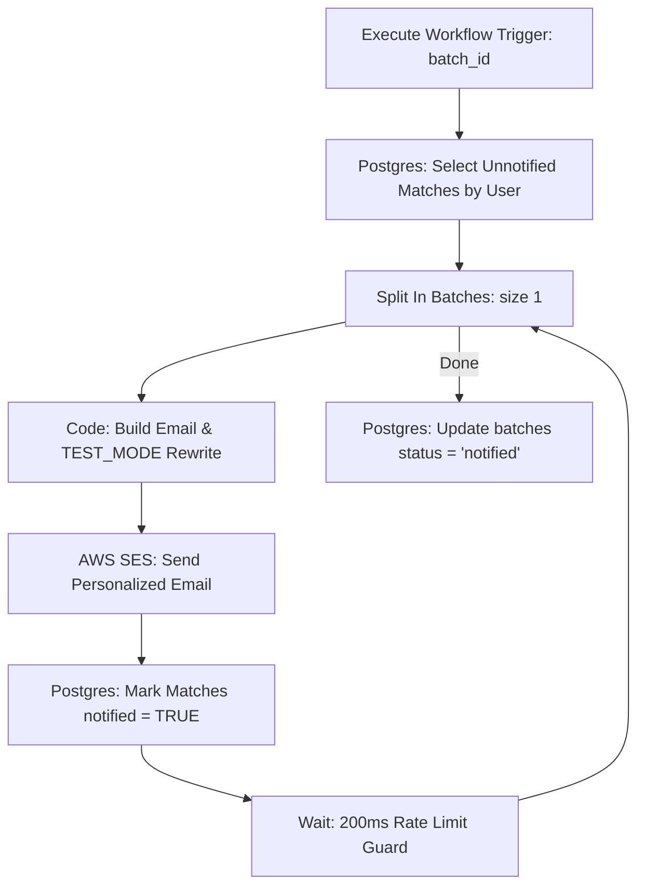

# Workflow C: User Notifications (SES & Test Mode)

This document is the architectural and operational guide for **Workflow C (The Notification Engine)**. It is invoked automatically by Workflow B upon completion of the matching pipeline (or triggered manually with a `batch_id`).

---

## 1. Node-by-Node Pipeline Architecture



---

## 2. Key Design & Safety Features

### A. Idempotency & Duplicate Prevention
Workflow C selects **only** applicants who have unnotified matches for the given batch:
```sql
SELECT 
    u.user_id,
    u.email,
    json_agg(
        json_build_object(
            'product_name', p.product_name,
            'source_site', p.source_site,
            'interest_rate', p.interest_rate,
            'margin', m.margin,
            'is_near_miss', m.is_near_miss,
            'reason', m.reason
        ) ORDER BY m.is_near_miss ASC, m.margin DESC
    ) AS matched_products
FROM matches m
JOIN users u ON m.user_id = u.user_id
JOIN loan_products p ON m.product_id = p.product_id
WHERE u.batch_id = $1::uuid
  AND m.notified = FALSE
GROUP BY u.user_id, u.email;
```
Once the email sends successfully, the user's records in `matches` are updated:
```sql
UPDATE matches SET notified = TRUE WHERE user_id = $1 AND notified = FALSE;
```
Re-running Workflow C for the same batch results in an empty query result, ensuring **zero duplicate emails are ever sent**.

### B. TEST_MODE Recipient Aliasing
To prevent sending unsolicited emails to demo/sample CSV addresses, the JavaScript formatting node enforces test routing:
```javascript
const isTestMode = String($env.TEST_MODE || 'true').toLowerCase() === 'true';
const gmailUser = $env.GMAILUSER || 'atharva.test';
const recipientEmail = isTestMode 
    ? `${gmailUser}+${userId.replace(/[^a-zA-Z0-9]/g, '_')}@gmail.com` 
    : rawEmail;
```
* In `TEST_MODE=true`, emails are delivered directly to your verified Gmail alias (e.g., `atharva+demo_001@gmail.com`).
* In production (`TEST_MODE=false`), emails are sent to the applicant's real address.

### C. Amazon SES Sandbox & Rate Compliance
AWS accounts in the SES Sandbox have a sending rate limit of 1 email/sec. Workflow C handles this gracefully via:
1. **Split In Batches (size 1):** Processes one applicant per iteration.
2. **Wait Node (200ms):** Enforces a rate pause between API requests to prevent HTTP 429 throttling errors.

### D. Clear Separation: Qualified Matches vs. Near Misses
The generated HTML email clearly separates:
* **Pre-Qualified Products:** Displays product name, source lender, interest rate, and a green "Eligible" badge.
* **Near Misses:** Highlights products where the user narrowly missed eligibility with an encouraging message (e.g., `"failed criterion: minimum credit score"` $\to$ `"Opportunity Within Reach: You were just a few credit points away from qualifying for Starter Personal Loan"`).
* **Compliance Disclaimer:** Clear statement that eligibility is subject to formal verification by the lender.

---

## 3. n8n Credentials & Setup

1. **PostgreSQL Credential:** Named `Loan Eligibility Postgres` (Host: `postgres`, Port: `5432`, DB: `loan_eligibility`).
2. **AWS SES Credential:** Named `AWS SES Credentials` (AWS Access Key ID, Secret Access Key, Region `ap-south-1`).
3. **Environment Variables:** Set `TEST_MODE=true`, `GMAILUSER=your.gmail.username`, and `SES_FROM_EMAIL=your-verified-identity@gmail.com`.

---

## 4. Verification

Run a test query after completion:
```sql
SELECT b.batch_id, b.status, b.matched_count, b.near_miss_count, b.emailed_count
FROM batches b
WHERE b.batch_id = 'YOUR_BATCH_ID';

SELECT user_id, product_id, is_near_miss, notified 
FROM matches 
WHERE notified = TRUE;
```
Confirm email arrival in your Gmail test inbox with subject:
`Your Personal Loan Eligibility Matches (Ref: demo-001)`
